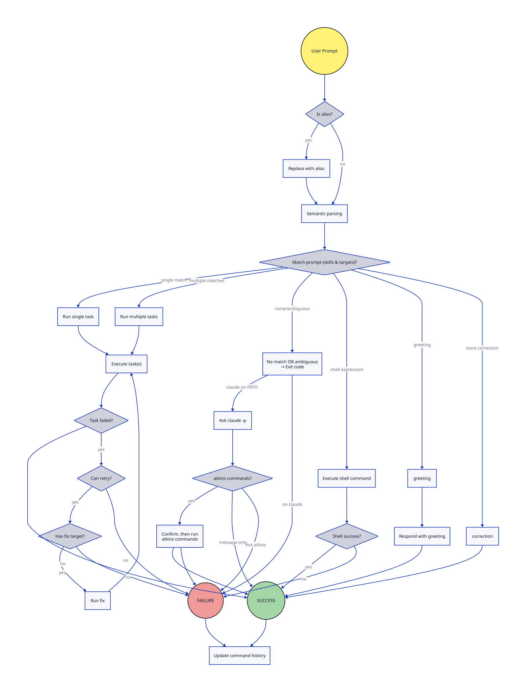

# Atkins Agent

The agent is a full-screen interactive REPL for running tasks. Start it with `atkins --agent`.

The agent takes human language inputs and runs shell commands, navigation and pipeline jobs. The prompt runs Atkins skills and creates aliases. It requires no LLM.

For non-interactive use, run a single prompt with `-x`:

```
atkins -x "go:test"              # run a skill
atkins -x "$ curl -s wttr.in"    # run a shell command ($ prefix)
atkins -x "list tasks"           # list available skills
atkins -x "hello"                # get a greeting
```

Language prompts define and invoke aliases. Teach an alias with `alias weather to curl -s wttr.in | head -n 7`, then invoke it with `how's the weather?`.

`structure.d2` describes the routing flow:



## Layout

The screen has three areas: a header bar showing version and hostname, a scrollable message log, and a footer bar showing the working directory, git branch, and git stats. Use PgUp and PgDn to scroll the log.

The footer border uses slate and teal colors and shows real-time git diff stats that update after each command. Stats show lines added and removed across both staged and unstaged changes.

### Prompt Modes

The prompt character indicates the current input mode:

| Prompt | Mode | Description |
|--------|------|-------------|
| `>` | Language | Natural language, task names, slash commands |
| `$` | Shell | Direct shell command execution |

Type `$` as the first character to switch to shell mode. The prompt displays in deep orange with command text in bright white. Backspace deletes the `$` to return to language mode.

## Running Tasks

Type a task name directly to run it. The agent also reads natural language: it strips filler words like "run", "the", and "please" and matches the remaining keywords against task names and descriptions.

Typing `go:test` runs that task directly. Typing `run tests` strips "run" and matches "tests" to a test task. Typing `run go tests` joins keywords to match `go:test`. The agent normalizes plural forms, so `tests` matches `test` and `queries` matches `query`.

### Retry Failed Commands

After a command fails, re-run it by typing `again`, `retry`, or `redo`.

### Command Chaining

Run tasks in sequence using `&&` or the word `then`. Typing `go:test && go:build` runs test first, then build if test passes. Typing `test then build` does the same using natural language.

### Typo Correction

If you mistype a command, the agent suggests corrections and waits for a confirmation. Type `y` to accept the suggestion or `n` to cancel.

## Slash Commands

| Command | Aliases | Description |
|---------|---------|-------------|
| `/list` | | List available skills and jobs |
| `/run <task>` | | Run a specific task |
| `/aliases` | | List defined aliases |
| `/cd <path>` | | Change working directory |
| `/help` | `/h`, `/?` | Show help |
| `/history` | | Show command history |
| `/debug` | | Toggle debug mode |
| `/verbose` | `/v` | Toggle verbose output |
| `/jail` | | Toggle jail mode (restrict to project scope) |
| `/quit` | `/q`, `/exit` | Exit |

Natural language also invokes slash commands. Typing `list`, `list tasks`, `tasks`, or `skills` all invoke `/list`. Typing `history` invokes `/history` and `help` invokes `/help`.

## Shell Commands

Shell commands require an explicit `$` prefix to execute. This prevents accidental command execution from typos or ambiguous input.

### Explicit Shell Mode

Type `$` followed by a space to enter shell mode. This changes the prompt from `>` to `$` displayed in deep orange. Commands like `$ curl wttr.in`, `$ ls -la`, and `$ git status` run directly as shell commands.

Examples:
- `$ curl wttr.in` - fetch weather
- `$ ls -la` - list files
- `$ git status` - check git status
- `$ docker ps` - list containers

### Shell History

The agent records shell commands in `~/.atkins/shell_history.json` with the command, exit code, duration, and working directory. The prompt shows history entries as suggestions for partial matches and does not run them on its own.

## Greetings

The agent responds to greetings and thanks in English, Spanish, French, Italian, German, and Portuguese. Responses come back in the matching language.

English greetings include hi, hey, hello, howdy, yo, and sup. Thanks include thanks, thank you, thx, and cheers. Other languages follow similar patterns with their native words.

Teach new greetings by typing something like `merhaba is a greeting`. The agent stores custom greetings in `~/.atkins/greetings.yaml`.

## Fortune

Get a fortune by typing `fortune`, `give me a fortune`, `inspire me`, or `quote`. Uses the system `fortune` command if available, otherwise returns a coding quote.

## Teaching Aliases

Teach the agent to map phrases to tasks or shell commands using patterns like:

- `alias server name to uname -n`
- `alias weather to curl wttr.in`
- `if I say deploy, run docker:push`
- `map lint to go:lint`
- `deploy means docker:push`

Aliases work with natural language. After teaching `alias server name to uname -n`, typing `server name` or `what's your server name` both run `uname -n` because the agent strips filler words.

Use `/aliases` to list all defined aliases. The agent stores aliases in `~/.atkins/aliases.yaml` and checks them before any other matching.

## Configuration Files

The agent keeps all configuration under `~/.atkins/`:

| File | Purpose |
|------|---------|
| `aliases.yaml` | Phrase to task mappings |
| `greetings.yaml` | Custom greeting words and responses |
| `shell_history.json` | Shell command execution history |
