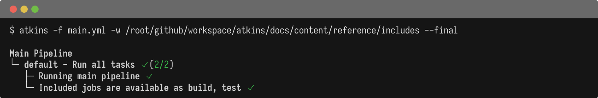

`include:` reads one or more files into `vars`, at the pipeline, job or step level. It does not merge jobs: Atkins ignores an included file's `jobs:` section, if it has one. To share jobs across files, use [Skills](../usage/skills).

## Basic Include

@tabs
@file "Main" includes/main.yml
@file "build.yml" includes/ci/build.yml
@file "test.yml" includes/ci/test.yml



`ci/build.yml` and `ci/test.yml` are plain YAML documents of variables. Their top-level keys land in `vars`, as if `main.yml` declared them.

## Merge Order

Atkins reads the included files in list order and the block's own `vars:` last. The last value read for a key sets it:

```yaml
include:
  - ci/build.yml   # tag: v1.2.3
  - ci/test.yml    # tag: v1.2.3-rc (read second)

vars:
  tag: v2.0.0        # read last, sets tag
```

## Relative Paths

Atkins resolves a path in `include:` from the current working directory of the `atkins` process. A pipeline that includes a file next to itself works when you run it from that directory. Write the include relative to the directory you run the pipeline from, or resolve it with `$(...)` first.

Atkins reads `include: ci/*.yml` as a literal filename and fails with "no such file or directory". List every file `include:` should read.

## Environment Includes

`env: include:` does the same for `env`, and reads a dotenv file of `KEY=value` lines:

```yaml
env:
  include: .env.production
  vars:
    LOG_LEVEL: debug   # read last, sets LOG_LEVEL
```

## See Also

- [Pipeline](./pipeline) - Pipeline configuration
- [Variables](./variables) - Variable interpolation
- [Skills](../usage/skills) - Sharing jobs across files
