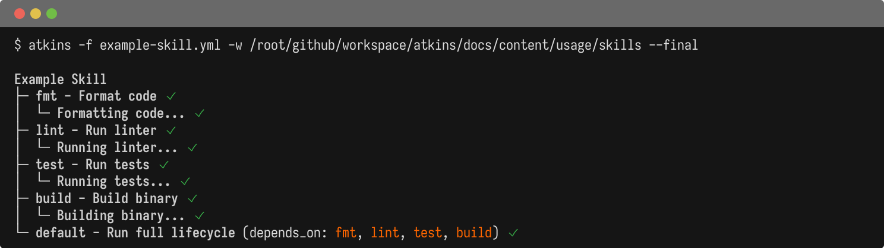

Skills are modular pipeline files that automatically activate based on project context. A Go skill can define `go:build`, `go:test`, and `go:lint` jobs that appear only when `go.mod` exists in your project. Skills let you build a library of reusable workflows that work across projects without copying configuration.

## Skill Locations

Skills are YAML pipeline files stored in special directories:

- `.atkins/skills/` - Project-local skills
- `.atkins/skills/` in a parent folder - Workspace skills (shared across the projects cloned inside it)
- `$HOME/.atkins/skills/` - Global skills (shared across all projects)

The nearest folder wins: a project skill shadows a workspace skill with the same name, and both shadow a global one.

Each skill file becomes a namespace. For example, `go.yml` creates jobs like `go:build`, `go:test`.

### Project Skills

```text
myproject/
├── .atkins/
│   └── skills/
│       ├── go.yml        (go:*)
│       ├── docker.yml    (docker:*)
│       └── deploy.yml    (deploy:*)
└── atkins.yml
```

### Global Skills

```text
$HOME/
└── .atkins/
    └── skills/
        ├── go.yml        (available in all projects)
        └── node.yml      (available in all projects)
```

Project skills take precedence over global skills with the same name.

### Skills from Parent Folders

A workspace checkout can hold tooling for every project cloned inside it:

```text
~/ws/
├── .atkins/
│   └── skills/
│       └── release.yml   (release:*, available in every project below)
└── dockerfiles/
    └── atkins.yml
```

Running atkins in `~/ws/dockerfiles` loads the project's own `.atkins/skills/`, then the `.atkins/skills/` of every parent folder, nearest first. Under `$HOME` the search stops below `$HOME`, because the global skills load on their own. Outside `$HOME` it goes on to the filesystem root. `atkins --help` and `atkins -l` list the parent folders' skills too. A pipeline file given with `-f` loads the skills of its own folder and the folders above it, the same as a discovered one.

## Creating a Skill

Skills are YAML pipeline files with a `when:` block for conditional activation:

@tabs
@file "Example Skill" skills/example-skill.yml
@file "When Activation" skills/when-activation.yml



The `when:` block controls when a skill is available. Listed files use OR logic - any match activates the skill. File patterns search upward from the current directory.

Atkins expands a pattern carrying `*`, `?` or `[...]` as a glob, so a skill can activate on what a folder holds, whatever its name:

```yaml
when:
  files:
    - schema/*.up.sql    # a folder of migrations, not any folder called schema
```

Two keys narrow the match:

- `here: true` keeps the search to the current directory. A `compose.yml` in a parent folder doesn't activate the skill, so a compose skill shows up only in the folder holding the file.
- `contains: <regexp>` requires the matched file to match a Go regular expression. With `contains:`, a folder never matches, and for a glob any matching file counts. Atkins reads up to 1 MiB of each candidate.

```yaml
when:
  files: [compose.yml, compose.yaml]
  here: true
  contains: '(?m)^\s+build:'    # only a compose file that builds an image
```

`atkins --lint` reports a `contains:` expression that doesn't compile; such a block never matches.

## Job Conditions

A job takes a `when:` block of its own, with the same keys and rules as the skill's. Atkins checks it from the directory atkins runs in. Where it doesn't match, the job leaves the `-l` listing, and running it, by name or through `task:`, fails with an error. The job keeps running in the skill's folder.

```yaml
name: Docker Compose
when:
  files: [compose.yml]
  here: true

jobs:
  up: docker compose up -d --remove-orphans
  build:
    when:
      files: [compose.yml]
      here: true
      contains: '(?m)^\s+build:'
    cmd: docker compose build
```

In a folder whose `compose.yml` builds an image, `atkins -l` lists `compose:build` and `compose:up`. In a folder whose `compose.yml` only pulls images, it lists `compose:up` alone.

## Job Arguments

A job with `args: true` takes arguments from the command line, after a bare `--`. Atkins appends them to every `exec:` step of the job as separate arguments:

```yaml
jobs:
  custom:
    desc: Run docker compose with arguments
    args: true
    steps:
      - exec: [docker, compose]
```

```bash
atkins compose:custom -- ps -a       # runs: docker compose ps -a
atkins compose:custom -- '; id'      # docker compose gets one argument, "; id"
```

An `exec:` step lists the program and its arguments and runs them without a shell. Atkins interpolates `${{ }}` in each item, and each item stays one argument. The arguments from the command line stay untouched: no interpolation, no globbing, no word splitting, so `$(id)`, `*` and `;` reach the program as typed. Atkins prints the output of an `exec:` step; `passthru: false` on the step turns that off.

Arguments need exactly one job on the command line, and that job must set `args: true`; anything else fails before a step runs. A `run:` or `cmd:` step of the same job never sees the arguments. A job that `task:` invokes from an `args: true` job gets them when it sets `args: true` itself.

## Skill Help

A skill states its purpose with `help:`, one or two sentences naming the files it reads and writes. `atkins --help` prints it beside the skill and the jobs decoded from the YAML.

```yaml
name: Go build and test
help: >-
  Generates, formats, lints, tests and builds a Go module. go:test writes the
  coverage profile pkg.cov; go:build writes bin/<name>-<goos>-<goarch>.
```

A skill may also carry a markdown file of the same base name beside it, `go.md` next to `go.yml`. This file is an optional usage guide for a skill whose typical use is not obvious from the job list, and `atkins --help` prints it under the skill. It documents typical use, not every job: the job list is already decoded from the YAML.

```markdown
`atkins go` runs the whole lifecycle: generate, fmt, lint, test, build.

- `atkins go:fmt` - format the sources.
- `atkins go:test` - run the tests and write the coverage profile `pkg.cov`.
```

`--vendor` copies the companion along with the skill file, and a change to the companion alone is enough to report the vendored skill as out of date.

## Skill Namespacing

Skills automatically namespace their jobs:

**go.yml** creates:
- `go:default`
- `go:build`
- `go:test`

Access them with:

```bash
atkins go:build
atkins go:test
```

## Aliases

Skills can define global aliases that map to namespaced jobs:

```yaml
jobs:
  build:
    aliases: [build, b]
    steps:
      - run: go build
```

Now `atkins build` invokes `go:build`.

### Alias Conflicts

Explicit job aliases take precedence over auto-generated aliases. For example, if a job has `aliases: [go]`, it overrides the automatic `go` to `go:default` mapping.

When two or more skills define the same explicit alias, project skills win over global skills.

To target explicitly:

```bash
atkins :go:build      # Explicit skill reference
atkins :docker:build  # Different skill
```

## Default Jobs

A skill can have a `default` job, enabling shorthand invocation:

```yaml
jobs:
  default:
    depends_on: [lint, test, build]
```

```bash
atkins go        # Runs go:default
```

## Cross-Skill References

Skills can reference each other using `:skill:job` syntax:

**release.yml:**

```yaml
jobs:
  release:
    steps:
      - task: :go:test
      - task: :go:build
      - task: :docker:build
      - task: :docker:push
```

## Skill Variables

Skills can define `vars:` at the pipeline level or job level. These variables are available to all jobs within the skill:

```yaml
name: Docker Skill

vars:
  image: myapp
  registry: docker.io

jobs:
  build:
    steps:
      - run: docker build -t ${{ registry }}/${{ image }} .
```

### Skill Variable Evaluation

When another pipeline invokes a skill (e.g., `task: docker:build`), the caller's variable stack carries to the skill. As the execution context already contains `name`, Atkins ignores the skill's own definition of `name`. Parameters can then come from the execution context, and the skill needs no default values for other execution paths that omit them.

```yaml
# Caller pipeline (atkins.yml)
vars:
  name: myapp
  semver: v2.0.0

jobs:
  deploy:
    steps:
      - task: docker:build
```

```yaml
# Skill (~/.atkins/skills/docker.yml)
vars:
  name: $(basename $(realpath -s .))    # ignored, caller provides "name"
  semver: $(git tag ... | tail -n 1)    # ignored, caller provides "semver"
  image: titpetric/${{ name }}           # added, resolves to "titpetric/myapp"
```

## Example Skills

### Go Skill

```yaml
name: Go build and test
when:
  files: [go.mod]

vars:
  binary: $(basename $(pwd))

jobs:
  default:
    depends_on: [generate, fmt, lint, test, build]

  generate:
    steps:
      - run: go generate ./...

  fmt:
    steps:
      - run: gofmt -w .
      - run: splint fix ./...

  lint:
    steps:
      - run: golangci-lint run

  test:
    aliases: [test]
    steps:
      - run: go test ./...

  build:
    aliases: [build]
    steps:
      - run: go build -o bin/${{ binary }} ./...
```

### Docker Skill

```yaml
name: Docker build and push
when:
  files: [Dockerfile]

vars:
  image: $(basename $(pwd))
  tag: $(git describe --tags --always)

jobs:
  build:
    aliases: [docker]
    steps:
      - run: docker build -t ${{ image }}:${{ tag }} .

  push:
    steps:
      - run: docker push ${{ image }}:${{ tag }}
```

### Node.js Skill

```yaml
name: Node.js
when:
  files: [package.json]

jobs:
  install:
    steps:
      - run: npm install

  build:
    depends_on: [install]
    steps:
      - run: npm run build

  test:
    depends_on: [install]
    aliases: [test]
    steps:
      - run: npm test
```

## Workspace Skills

A workspace skill in `[project]/.atkins/skills/` applies to the entire project.

**With `when:`** - the working directory is the folder containing the matched file.

**Without `when:`** - the working directory is the folder containing `.atkins/`. This allows the skill to run project-level commands from the workspace root. A skill from a parent folder runs in that parent folder: `release.yml` from `~/ws/.atkins/skills/` runs in `~/ws`, also when invoked from `~/ws/dockerfiles`.

### Global Skill Behavior

Global skills in `~/.atkins/skills/` are available everywhere without populating your source tree.

Global skills do not change the working directory. They run from wherever you invoke atkins, unless:

- They have a `when:` that matches a file (uses that file's folder)
- They explicitly set `dir:` in the pipeline

### Project Structure

The main pipeline and `.atkins/` folder define workspace boundaries:

```
/project/.atkins/          # workspace skills
/project/atkins.yml        # main pipeline
/project/app/compose.yml   # matched by compose skill
/project/app/sub/          # can invoke skills from here
```

From `/project/app/sub/`, atkins searches upward to find configuration and skills. A compose skill with `when: files: [compose.yml]` would match `/project/app/compose.yml` and run from `/project/app/`.

A nested `.atkins/` folder or pipeline starts its own workspace. It still sees the skills of the workspaces above it, and its own skills shadow theirs.

## Jail Mode

To disable global skills:

```bash
atkins --jail
```

This only loads skills from the project's `.atkins/skills/`, ignoring the parent folders and `$HOME/.atkins/skills/`.

Useful for:
- Reproducible CI builds
- Avoiding personal customizations
- Testing project-only configurations

## Vendoring

Global skills live on one machine. A pipeline that leans on `~/.atkins/skills/compose.yml` runs on the author's laptop and fails on a clean clone, and a CI agent is exactly the machine with no personal skills directory.

`--vendor` reports the skills a repository uses and what copying them would change:

```bash
atkins --vendor
```

```text
Found 7 local skills.
Found usage for 3 skills.
  + docker  +45 -0 (new)
  ✓ go      (up to date)
  ~ mdox    +4 -1 (changed)
Would install: docker, mdox.
Run atkins --vendor --write to write them.
```

A skill already vendored unchanged gets a checkmark; a new or changed skill gets the lines the write adds and removes. `--debug` adds the reason behind each skill selection, and the diff behind the counts.

The command writes nothing until `--write`:

```bash
atkins --vendor --write
```

```text
Found 7 local skills.
Found usage for 3 skills.
  + docker  +45 -0 (new)
  ✓ go      (up to date)
  ~ mdox    +4 -1 (changed)
Installed: docker, mdox.
```

Vendoring writes skills to `.atkins/skills/` next to `.git`, so they apply to the whole repository, and creates the folder if it doesn't exist yet. The copies are ordinary repository content: commit them like any other dependency, and an update is a re-run and a diff.

A vendored copy that has drifted from its source is overwritten. Skills are files under version control, so reverting a change you wanted to keep is `git checkout`. The dry run shows the diff first for that reason.

### Selection Rules

Vendoring selects a skill when any of these hold:

- Its `when:` block matches a path anywhere in the repository. The search descends the tree and never climbs it, so a `schema/*.up.sql` file in a submodule selects the schema skill, the same way it activates there.
- It has no `when:` block, which makes it active everywhere.
- A pipeline in the repository names one of its jobs through `task:` or `depends_on:`. A reference to `docker:build` selects the docker skill even without a `docker/Dockerfile`.
- A skill already selected names one of its jobs. A release skill calling `:docker:build` brings the docker skill with it.

Dot directories and `node_modules`, `vendor`, `testdata`, `bin`, `dist` and `coverage` are not descended into.

`--vendor` does not combine with `--jail`, which excludes the `$HOME/.atkins/skills` that vendoring reads from.

## Listing Skills

View all active skills and their jobs:

```bash
atkins -l
```

Output shows skills after the main pipeline:

```
My Project

* default:    Run all
* build:      Build app

Aliases

* go:         (invokes: go:default)
* test:       (invokes: go:test)

Go build and test

* go:default: Go lifecycle
* go:build:   Build binary
* go:test:    Run tests
```

### Listing as JSON

`atkins -l --json` describes each section of the listing for tooling. The YAML form, `-l --yaml`, carries the same fields.

```json
[
  {
    "id": "compose",
    "kind": "skill",
    "path": "/home/user/ws/.atkins/skills/compose.yml",
    "dir": "/home/user/ws/pulse",
    "active": true,
    "when": {
      "files": ["compose.yml"],
      "here": true,
      "matched": "/home/user/ws/pulse/compose.yml"
    },
    "desc": "Docker Compose",
    "cmds": [
      {
        "id": "compose:custom",
        "name": "custom",
        "desc": "Run docker compose with arguments",
        "cmd": "atkins compose:custom",
        "interactive": false,
        "args": true,
        "exec": ["docker", "compose"],
        "active": true
      }
    ]
  }
]
```

| Field         | Meaning                                                                 |
|---------------|-------------------------------------------------------------------------|
| `id`          | The skill namespace; empty for the main pipeline and the aliases        |
| `kind`        | `pipeline`, `skill` or `aliases`                                        |
| `path`        | The file the section loads from                                         |
| `dir`         | The folder the jobs run in; empty for the aliases and an inactive skill |
| `active`      | `false` for a skill whose `when:` block doesn't match                   |
| `when`        | The `when:` block, with `matched` naming the file that satisfied it     |
| `cmds[].name` | The job name without the skill prefix, or the alias                     |
| `cmds[].args` | The job takes arguments after `--`                                      |
| `cmds[].exec` | For a job with `args`, the `exec:` argv of its first such step          |
| `cmds[].when` | The job's own `when:` block and its match                               |

`--all` adds the skills whose `when:` block doesn't match, with `active: false`, so a caller sees every skill installed for a folder. A job whose own `when:` block doesn't match stays out, with or without `--all`.

## See Also

- [Configuration](./configuration) - Pipeline format details
- [Job Targeting](./job-targeting) - Running specific jobs
